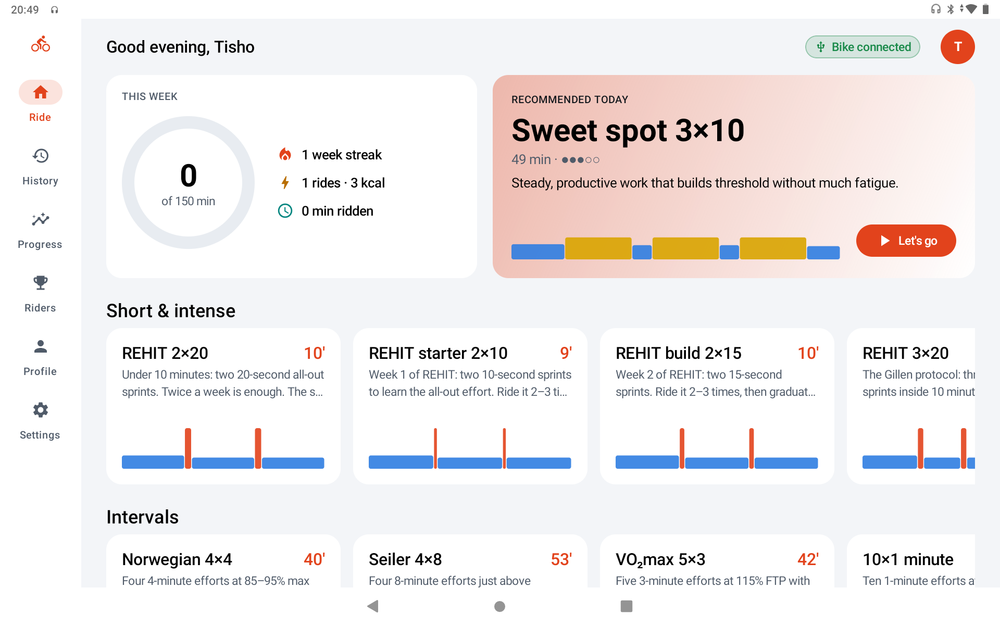
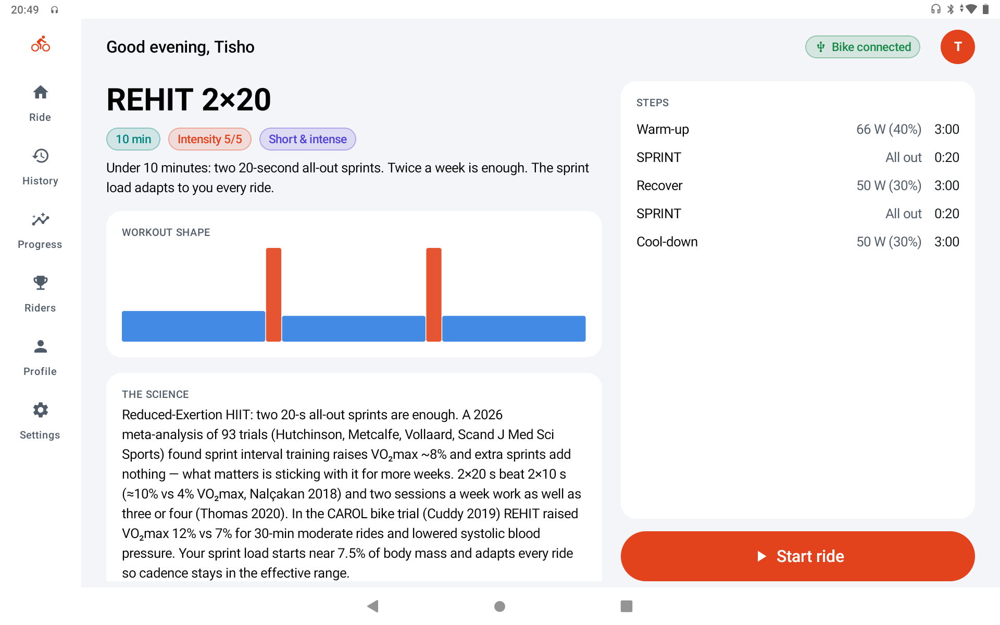
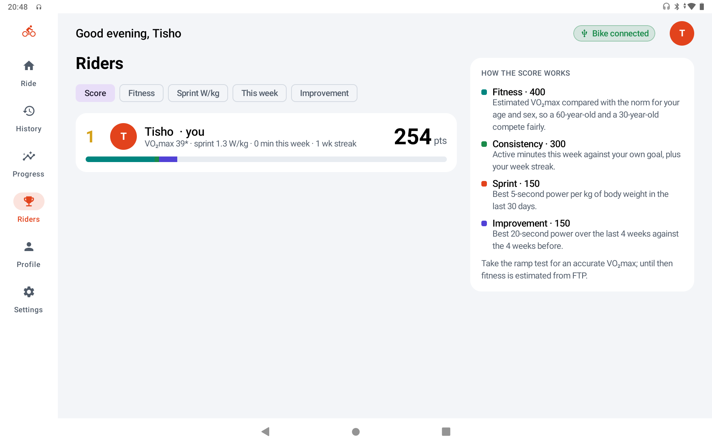
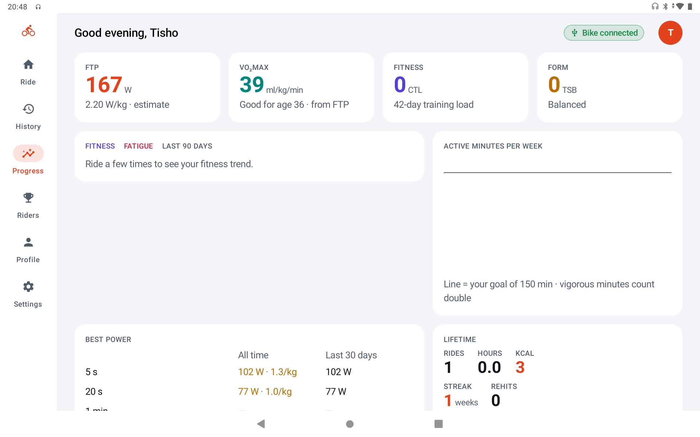

# REHIT Rider

A free Android trainer app for exercise bikes with the FTDI USB control board, as found in some CAROL bikes. It
connects to the bike directly over USB: no account, no subscription and no internet needed. All data stays on the
tablet.

| | |
|---|---|
|  |  |
|  |  |

## Features

- **29 workouts** based on published research, plus a builder for your own
- **Adaptive REHIT:**
  - Each rider's sprint load starts at the research standard: 7.5% of body mass, or 5% for riders aged 60+.
  - After every ride it adapts to your cadence at the end of each sprint.
- **ERG mode:** interval targets are set as a percentage of your FTP, and the bike adjusts resistance to hold the watts whatever your cadence.
- **Several riders:** "Who's riding?" at launch, with separate profiles, history and progress.
- **Guest riding:** anyone can ride without creating a profile; guest rides stay out of the leaderboard and syncing.
- **Virtual distance and speed** from your power, using the same road-physics model as indoor cycling apps.
- **Simple difficulty control:** 0–20, one step per tap, with the bike following behind.
- **Workouts named by what they do:** for example "Fat burn · 30 min" or "Heart & VO₂max · 40 min", with the protocol name (Norwegian 4×4, Tabata and so on) shown as a subtitle.
- **Riders leaderboard:** a 1,000-point score that is fair across ages and body sizes. It combines fitness for your age, consistency, sprint power per kg, and improvement.
- **Live ride screen:**
  - power, cadence, heart rate (from the bike's hand grips or any Bluetooth strap) and resistance
  - voice coaching and auto-pause
- **Personalised calories** from measured work, heart rate and your profile (age, weight, height, sex).
- **Progress:** FTP, estimated VO₂max, fitness and fatigue trend, weekly active minutes, best efforts and personal records.
- **Phone sync:** each rider's rides go to their own phone's Google Fit / Samsung Health.
- **Starts with the tablet**, as its home app.
- **Your data:** backup and restore, CSV export, and TCX export for Strava or Garmin.

## Workouts

| Workout | Time | What it is | Research |
|---|---|---|---|
| **REHIT 2×20** | 10 min | Two 20-s all-out sprints. Twice a week is enough. | Metcalfe 2012; Vollaard 2017; Hutchinson 2026 meta-analysis (93 trials, +8% VO₂max); Thomas 2020; Cuddy 2019 (CAROL trial: +12% VO₂max, lower blood pressure) |
| REHIT starter 2×10, build 2×15 | 9–10 min | Two-week on-ramp before 2×20 | Nalçakan 2018 (2×20 beats 2×10); Metcalfe protocols |
| REHIT 3×20 | 10 min | Three sprints | Gillen 2016 |
| Micro-sprints 6×6 | 13 min | Gentle 6-s bursts, good for older riders | Adamson 2019 |
| Sprint intervals 4×30 | 22 min | Classic Wingate sprints (advanced) | Vollaard & Metcalfe 2017 |
| Tabata 20/10 | 15 min | 8 × (20 s very hard / 10 s easy) | Tabata 1996 |
| Norwegian 4×4 | 40 min | 4 × 4 min at 85–95% max HR | Helgerud 2007; Stensvold 2020 |
| Seiler 4×8 | 53 min | 4 × 8 min just above threshold | Seiler 2013; Wen 2019 |
| VO₂max 5×3 | 42 min | 5 × 3 min at 115% FTP | Wen 2019 |
| 10×1 minute | 29 min | 10 × 1 min at ~90% max HR | Little 2010 |
| 60/30 intervals | 43 min | 2 × 8 × (60 s hard / 30 s easy) | Millet 2003; Rønnestad 2015; Almquist 2020 |
| Rønnestad 30/15 | 50 min | 3 × 13 × (30 s / 15 s) | Rønnestad 2015 |
| 40/20 microbursts | 40 min | 2 × 10 × (40 s / 20 s) | Coaching practice |
| Over-unders 3×9 | 52 min | Alternating 95% and 108% FTP | Coaching practice |
| Pyramid | 41 min | 1-2-3-4-3-2-1 min efforts | Mixed-interval HIIT |
| Sweet spot 3×10 | 49 min | 3 × 10 min at 90% FTP | Coggan and Allen |
| Threshold 2×20 | 60 min | 2 × 20 min at 97% FTP | Coggan |
| Rolling hills | 30 min | Climbs and descents at steady cadence | — |
| Low-cadence tempo 4×6 | 48 min | Big-gear strength-endurance | Kristoffersen 2014 |
| Zone 2 · 30, 45 or 60 min | 30–60 min | Easy aerobic base | Seiler 2010; Storoschuk 2025 |
| Steady 30 | 30 min | Moderate and steady | ACSM |
| Recovery spin | 20 min | Very easy | — |
| **Ramp FTP test** | ~20 min | +20 W/min until you can't go on (+10 W/min for riders under 60 kg or aged 60+) | FTP ≈ 75% of best 1-min power; ACSM VO₂ equation |
| 20-minute FTP test | 45 min | Classic test: FTP = 95% of 20-min power (92% for recreational riders) | Borszcz 2019 |
| Free ride, power hold (ERG) | open | Ride your own way | — |

## Install

1. Download `rehit-rider-*.apk` from [Releases](../../releases) and install it on the bike's tablet.
2. Plug in the bike's USB cable, open **REHIT Rider**, and allow USB access (tick "Use by default").
3. Optionally set it as the home app (Android asks when you press Home), so it starts with the tablet.

Tablets locked by a kiosk app (for example MobiLock) may block installs. A factory reset removes the kiosk.

## Phone sync (optional)

1. Install `rehit-rider-sync-*.apk` on your Android phone. It needs Health Connect.
2. On the tablet: **Settings → Sync to my phone → Link a phone**, then enter the code in the phone app. Both devices must be on the same Wi-Fi.

Each phone only receives the rides of the rider it was linked to.

## Build

Open `ride/` in Android Studio, or run `gradle assembleRelease`. It needs JDK 17, SDK 36 and Gradle 8.12.1.

## Disclaimer

Provided as is, without warranty of any kind. Use at your own risk. This is not medical advice: check with a doctor
before hard exercise and stop if you feel unwell.

Not affiliated with or endorsed by CAROL Bike or Integrated Health Partners Limited. CAROL is a trademark of its owner.
